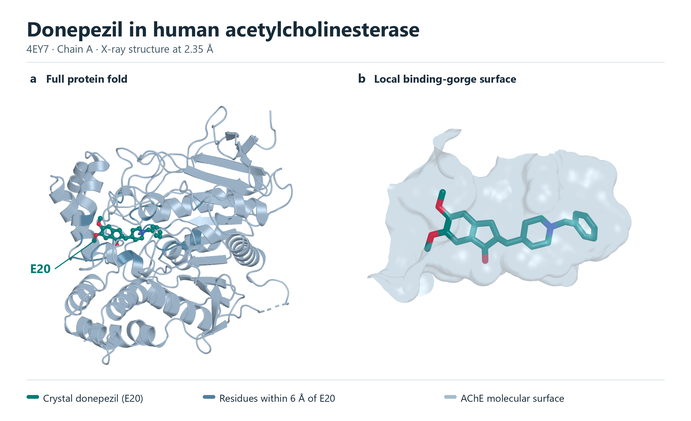
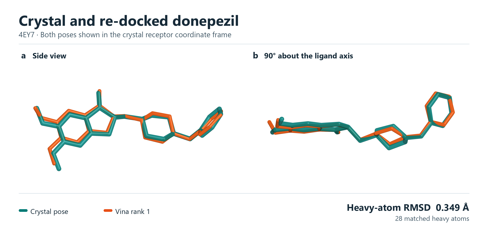
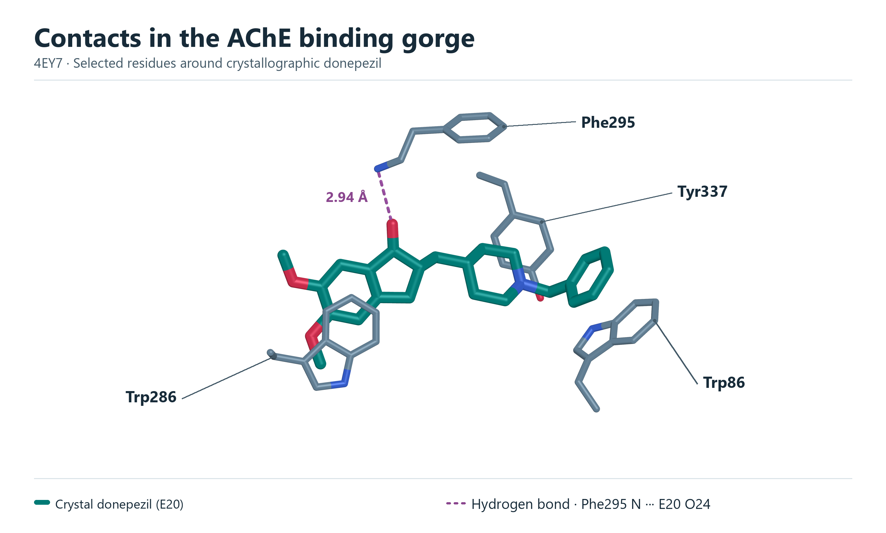

# 4EY7 多奈哌齐再对接

JLU-CP Dry Lab · 技术考核 · 任务 1 / 方案 B

本项目对人乙酰胆碱酯酶 A 链与多奈哌齐进行刚性受体再对接。AutoDock Vina 输出 9 个候选姿势。按 Vina 打分排名第一的姿势取得 **0.3488 Å** 的晶体重原子 RMSD，满足题目规定的 **RMSD < 2 Å**，判定为重现成功。

| 结果项 | 数值 |
| --- | ---: |
| Vina 第 1 名打分 | −12.211 kcal/mol |
| 第 1 名对晶体配体的 RMSD | 0.3488 Å |
| 配对重原子数 | 28 |
| 晶体配体中心（x, y, z） | (−14.1085, −43.8327, 27.6699) Å |
| 搜索框边长 | 24 Å |

逐姿势分数与晶体 RMSD 见 [pose_metrics.tsv](docking/pose_metrics.tsv)，第 1 名汇总见 [result.json](docking/result.json)，原始运行记录见 [vina.log](docking/vina.log)。

## 数据来源

选用 **RCSB PDB 4EY7**。这是人乙酰胆碱酯酶与多奈哌齐的 **2.35 Å X 射线晶体结构**，包含同一坐标系下的受体和已结合配体，符合方案 B 的要求。参考配体为 A 链的 E20 604。 [RCSB PDB 4EY7](https://www.rcsb.org/structure/4EY7) · [Cheung 等，2012](https://doi.org/10.1021/jm300871x)

| 仓库原始文件 | 用途 | 公开来源 |
| --- | --- | --- |
| [data/4EY7.pdb](data/4EY7.pdb) | 受体与实验配体原子坐标 | [RCSB 结构文件](https://files.rcsb.org/download/4EY7.pdb) |
| [data/E20.cif](data/E20.cif) | E20 的原子名称、元素、连接关系和键级 | [RCSB 化学组分字典](https://files.rcsb.org/ligands/download/E20.cif) · [E20 条目](https://www.rcsb.org/ligand/E20) |

两份原始文件已随仓库提供。可用 `Get-FileHash data/4EY7.pdb,data/E20.cif` 对照以下 SHA-256 摘要。

```text
4EY7.pdb  6bca2109d7b512a576458c3261e597bb5159e8fb43162c5b6c88df71f9fcdbd2
E20.cif   615879f6e5e1a27b4690643ff95bea8e64ff4f5b2830bcb16e5864dd8211681f
```

## 结果图



**图 1｜整体结构。** 左侧显示 A 链蛋白折叠并标出 E20，右侧以相同观察方向放大结合沟，用半透明分子表面展示 E20 在沟槽中的位置。

深色丝带标出有原子距 E20 不超过 6 Å 的残基。局部图显示从完整 A 链计算、按与 E20 的距离截取的分子表面。



**图 2｜结构叠合。** 晶体姿势（青色）和 Vina 得分第 1 名（橙色）以相同尺度从相差 90° 的两个方向显示，28 个重原子的 RMSD 为 0.349 Å。



**图 3｜晶体结合口袋。** 标注 Trp86、Trp286、Phe295 和 Tyr337，并用紫色虚线标出 Phe295 主链 N 与 E20 羰基 O24 之间的氢键几何（2.94 Å）。

N···O 距离取自晶体重原子坐标。在 Meeko 加氢模型中，H···O 距离为 1.95 Å，N–H···O 角约为 159°。其余标注残基与 E20 的最近重原子间距分别为 Trp86 3.41 Å、Trp286 3.55 Å 和 Tyr337 3.25 Å。

## 在 Windows 上复现

### 1. 安装工具

安装 64 位 Python 3.13，在项目根目录打开 PowerShell。下列命令新建项目内虚拟环境，并安装固定版本的依赖。Meeko 负责 PDBQT 参数化和结果导出，RDKit 负责配体分子图与重原子对应，PyMOL 负责分子场景渲染。

```powershell
python -m venv .venv
$Py = ".\.venv\Scripts\python.exe"
& $Py -m pip install -r requirements.txt
```

从 Vina 1.2.7 官方发布页下载 `vina_1.2.7_win.exe`。在项目根目录建立 `.tools`，把下载的文件存为 `.tools/vina.exe`，然后执行 `& ./.tools/vina.exe --version`，应显示 `AutoDock Vina v1.2.7`。 [Vina 1.2.7 官方发布页](https://github.com/forlilab/AutoDock-Vina/releases/tag/v1.2.7)

### 2. 拆分结构、加氢并生成配置

```powershell
& $Py prep/prepare.py
& $Py -m meeko.cli.mk_prepare_receptor --read_pdb docking/receptor_A.pdb -p docking/receptor_A.pdbqt
```

受体保留 A 链的蛋白 `ATOM` 坐标与三对二硫键注释，共 4,130 个输入原子。备用位置保留空白或 A 标识。水、NAG、EDO、NO3 等非蛋白组分均从受体排除。配体坐标单独提取自 A 链 E20 604。Meeko 按残基模板补氢并分配 Gasteiger 部分电荷。

配体坐标取自晶体，键级和连接关系取自 E20 字典，两者按 PDB 原子名对应。晶体配体 C8 为 R 构型。对接采用哌啶氮 N14 质子化的单正离子模型，经 RDKit 加氢和 Meeko 参数化写出 PDBQT。原始配体重原子间最大距离为 15.48 Å，以 28 个重原子的几何中心构建边长 24 Å 的搜索框。

### 3. 再对接并计算 RMSD

```powershell
& ./.tools/vina.exe --config docking/vina_config.txt | Tee-Object -FilePath docking/vina.log
& $Py -m meeko.cli.mk_export docking/vina_poses.pdbqt -s docking/vina_poses.sdf
& $Py prep/evaluate.py
```

配置固定随机种子为 2027，搜索强度为 32，使用 4 个 CPU 线程，最多输出 9 个姿势，能量窗口为 4 kcal/mol。使用 Vina 默认评分函数，按输出打分取第 1 名。

评估比较两组重原子在同一坐标系中的对应距离。脚本在用于比较的分子图中统一氮质子化表示，检查元素、键和手性，枚举 4 个对称等价的原子映射，并报告其中最小的 RMSD。RMSD 等于对应原子距离平方的平均值再开方，全程保持原坐标。Vina 日志表格里的 `rmsd l.b.` 和 `rmsd u.b.` 则衡量候选姿势相对 Vina 第 1 名的偏差。

在同一环境中从原始数据复跑后，两份输入 PDBQT、Vina 姿势 PDBQT 和两份指标文件均与本仓库的结果逐字节相同。独立调用 RDKit 的 `CalcRMS` 得到 0.3487879 Å。

### 4. 渲染和排版

```powershell
& $Py -m pymol -cqy pymol/figures.pml
& $Py pymol/compose.py
```

PyMOL 以光线追踪生成分子图层。排版脚本在白底上添加标题、图例和标注，并检查成对面板的尺寸、分子裁边和标签与分子图层的间距。三张 PNG 分别为 **2760 × 1685、2760 × 1320 和 2760 × 1660** 像素，均写入 300 dpi 元数据。

## 考核问题

### 1. 再对接验证了什么？

再对接验证一套对接流程能否在给定的受体结构和结合口袋中重现已知配体的结合姿势。先移除晶体中的配体，再让 Vina 搜索并对候选姿势评分。用同一受体坐标系内的重原子 RMSD 比较最高分预测与实验参考，就能评估本体系的姿势恢复表现。该结论适用于本次设置，其中已知口袋位置、受体为配体结合态，且配体输入保留了晶体的内部几何。

### 2. 最终 RMSD 与判定

Vina 第 1 名与晶体 E20 的重原子 RMSD 为 **0.3488 Å**，小于 2 Å，结构重现成功。评价指标反映姿势偏差，Vina 分数则用于本次候选姿势的排序。

### 3. 耗时最长的步骤与解决方式

本次运行耗时最长的是在 Windows 上配齐 Vina 和 PyMOL。常规下载遇到连接中断，最终用 Windows 原生 curl 重试，从 GitHub 官方资产接口下载 Vina 并核对发行文件大小与版本，再从 PyPI 获取兼容 Python 3.13 的 PyMOL wheel 并核对 SHA-256。装好后用固定配置执行对接，并用实际输出生成三张图。

## 文件索引

| 路径 | 内容 |
| --- | --- |
| [data/](data/) | 4EY7 晶体结构和 E20 化学组分字典 |
| [prep/](prep/) | 结构提取、配体参数化、搜索框生成与 RMSD 脚本 |
| [docking/](docking/) | 受体及配体文件、配置、Vina 日志、姿势和指标 |
| [pymol/](pymol/) | 可批处理的 `.pml` 脚本与 PNG 排版脚本 |
| [figures/](figures/) | 三张最终图 |
| [AI_USAGE.md](AI_USAGE.md) | AI、环境与提示词记录 |

方法参考 [AutoDock Vina 1.2](https://doi.org/10.1021/acs.jcim.1c00203) · [AutoDock Vina 入门教程](https://autodock-vina.readthedocs.io/en/latest/docking_basic.html) · [Meeko 文档](https://meeko.readthedocs.io/en/develop/).
